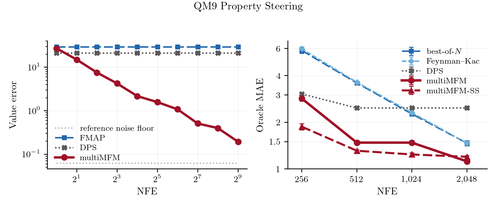

# MultiMFM

**Inference-time steering for physical-property-guided molecular generation with meta flow maps.**


**Authors:** Ulrik Unneberg and Franklin Shiyi Wang.
Kempner Institute, Harvard University.


MultiMFM steers a pretrained 3D-molecule flow-matching model toward a target
physical property (polarizability, heat capacity, dipole, HOMO/LUMO/gap) *at
inference time* — no property-conditional retraining. A distilled **meta flow map
(MFM)** provides a cheap few-step posterior estimate that turns a property
regressor into a value gradient, and **`steer_search`** selects the best
PoseBusters-valid molecule along each guided trajectory.


<p align="center">
  
</p>

## Method

1. **Base flow model** — a TABASCO discrete-flow-matching (DFM) transformer trained
   unconditionally on QM9 (`checkpoints/base_flow/`).
2. **Meta flow map (MFM)** — a flow-map "student" distilled from the base model's
   GLASS posterior. It maps a noisy state to a fast few-step clean-sample estimate,
   used as the **value sampler** during guidance (`checkpoints/mfm_student/`).
3. **Value-gradient guidance (GLASS)** — at each sampling step, guide the velocity by
   `∇ₓ log E[exp(λ·r) | xₜ]` with reward `r = -(predicted_property - target)²`,
   estimated with the MFM student and a differentiable property **guide** regressor.
4. **`steer_search` (SS)** — the `return_best` variant. At every in-window step the
   model exposes a look-ahead clean-sample endpoint; `steer_search` harvests them,
   keeps only those that pass PoseBusters, and returns the valid endpoint whose
   guide-predicted property is closest to target. This lifts both validity and
   accuracy over returning the final endpoint.

Property accuracy is reported against a held-out **oracle** regressor (never used for
steering) alongside PoseBusters validity.

## Results (QM9, n = 1000)

Oracle MAE and PoseBusters validity, held-out oracle, n = 1000 per property
(`results/qm9/table2.csv`, `results/qm9/table21.csv`):

| Property | unguided | multiMFM | multiMFM-SS |
|---|---:|---:|---:|
| Cv, cal/(mol·K) | 3.485 (0.987) | 0.417 (0.903) | **0.402** (0.974) |
| μ, D | 1.699 (0.987) | 0.843 (0.916) | **0.686** (0.958) |
| α, Bohr³ | 9.098 (0.987) | 1.120 (0.913) | **1.104** (0.975) |
| gap, meV | 1914 (0.987) | 600 (0.909) | **471** (0.963) |
| HOMO, meV | 740 (0.987) | 262 (0.923) | **252** (0.978) |
| LUMO, meV | 1515 (0.987) | 392 (0.922) | **316** (0.978) |

`steer_search` (SS) wins on both axes against plain steering: lower error *and* higher validity,
because it only ever returns a PoseBusters-valid look-ahead endpoint. Returning the final endpoint
instead costs 0.13-0.25 of validity at the same settings (`ss_final_endpoint_pb_valid_*` in
`table21.csv`).

**The SS column is the mean of two independent replicates**, not the better of them -- except LUMO,
where only one replicate exists. The per-property spread between replicates is real (α 1.152 vs
1.057, gap 462 vs 480), so quoting a replicate-by-replicate pick would overstate SS by up to 2%.
Both replicates are in the CSV.

### Against baselines at matched inference cost

Every method integrates the same 128-step outer trajectory, so the whole budget difference is the
value estimator. Steering α, held-out oracle, PoseBusters-valid ≥ 0.75, 3 seeds. Each cell is the
best error the method reaches within 15% of that budget, which is how the figure above is drawn --
`scripts/paper/qm9_figure.py` produces both, and `notebooks/10_qm9_steering_figure.ipynb`
reproduces them on CPU.

| fwd-equiv. NFE | multiMFM | multiMFM-SS | DPS | best-of-N | Feynman–Kac |
|---:|---:|---:|---:|---:|---:|
| 256 | 2.851 | **1.875** | 3.051 | 5.824 | 5.964 |
| 512 | 1.479 | **1.311** | 2.477 | 3.592 | 3.629 |
| 1,024 | 1.479 | **1.240** | 2.477 | 2.266 | 2.308 |
| 2,048 | **1.120** | 1.199 | 2.477 | 1.466 | 1.467 |

Both arms are below every baseline at every budget. multiMFM beats DPS by 1.07–2.21×; multiMFM-SS
beats DPS by 1.63–2.07× and best-of-N by 1.22–3.11×. The sharpest single statement:
**multiMFM-SS at 512 calls (1.311) beats best-of-N at 2,048 (1.466)** — lower error at 4× less
compute.

DPS flattens at 2.477 because its value estimate is a single denoiser call: it has no *N* to spend,
so extra budget buys it nothing. That is the same fact the left panel measures directly.

### Value-function estimation

The quantity guidance needs is *V_t(x)* = log E[e^{r(X₁)} | X_t = x]. multiMFM estimates it as a
log-mean-exp over *N* flow-map posterior samples, so it has an *N* to spend; the point estimates
do not. Against a 4,096-sample GLASS reference over 32 conditioning states
(`results/qm9/value_error.csv`):

| *N* | 1 | 8 | 64 | 512 |
|---|---:|---:|---:|---:|
| **multiMFM** | 27.33 | 4.26 | 1.08 | **0.19** |
| DPS | 21.27 | 21.27 | 21.27 | 21.27 |
| FMAP | 29.68 | 29.68 | 29.68 | 29.68 |

multiMFM passes both point estimates by *N* ≈ 2 and ends **110×** below DPS. The reference's own
self-split spread is 0.062, under every measured point, so the whole range is resolved rather
than floor-limited — see `results/qm9/VALUE_ERROR.md`.


## Setup

Requires [micromamba](https://mamba.readthedocs.io/) and (for guided sampling) a CUDA GPU.

```bash
micromamba env create -f environment.yml   # creates the `multimfm` env
micromamba activate multimfm
```

`scripts/env.sh` activates the env, points the Hugging Face cache at `data/qm9` and wires up the
CUDA runtime libraries. The QM9 cache itself is one of the fetched artifacts (see **Data & weights**):

```bash
source scripts/env.sh
```

### Tests

```bash
python -m pytest tests -q
```

All 28 pass once the artifacts are fetched. Without them 18 pass, 6 skip and 4 fail: the
skips and failures are the DNA tests that load a checkpoint or the parent-split file, which
check that the shipped sbatch wrappers reproduce each model's recorded training arguments.
They need the real artifacts and nothing else.

## Usage

### Steer toward a property with `steer_search`

```bash
# reproduces the SS config for one property (alpha|cv|gap|homo|lumo|mu)
scripts/run_steer_search.sh alpha 1000

# or call the module directly
python -m multimfm.steer_search --property-name alpha \
    --mu 11 --reward-scale 0.3 --select-min-t 0.3 --num-samples 1000 --mfm-diagonal
```

Defaults point at the bundled checkpoints; results (oracle MAE + PB-valid for the final,
raw-best, and PB-valid-best endpoints) are written to `outputs/steer_search/<property>/`.

### Training (QM9)

Both QM9 models ship as checkpoints (`checkpoints/base_flow/model_step_100000.pt`,
`checkpoints/mfm_student/student_step_1000.pt`); retraining is not needed to reproduce the
tables and is not bit-reproducible.

```bash
# 1) base QM9 flow-matching model (Table 19). The trainer is multimfm.qm9_data, NOT
#    multimfm.train_base_flow (the generic RDKit/GEOM trainer). Replays the "args" stored in
#    the shipped checkpoint: train_flow partition, 50k molecules, <= 9 heavy atoms,
#    batch 128, 100k steps, 4 layers x 64 wide x 4 heads, lr 2e-3, seed 0.
sbatch scripts/qm9/train_base.sbatch          # -> outputs/qm9/base_flow/.../checkpoints/model_step_100000.pt

# 2) meta flow map (Table 20): only the FINAL distillation phase can be replayed
#    (python -m multimfm.train_mfm_student --stage 1 --rollout-condition-source generated ...,
#    1000 updates, EMA 0.999). It starts from an earlier MFM checkpoint
#    (spr4 stage-4, step 3000) that was purged, so it must be supplied:
INIT_CKPT=/path/to/student_step_3000.pt sbatch scripts/qm9/train_mfm.sbatch
```

Both read QM9 from the bundled offline cache under `data/qm9/`. Stored hyperparameters:
`results/qm9/table19_base_training.json`, `results/qm9/table20_mfm_training.json`.

## Repository layout

```
src/tabasco/            Base flow-matching library (backbone, GLASS sampler, MFM transformer)
src/multimfm/           Molecules: steering + training drivers
  steer_search.py         steer_search (SS): PB-valid best-of-lookahead selection
  glass_guidance.py       value-gradient guidance core
  glass_posterior.py      GLASS posterior / endpoint prediction
  glass_endpoints.py      data endpoints + condition-state helpers
  qm9_data.py             QM9 loading + TFG-Flow guide/oracle regressors
  property_targets.py     length-conditioned property-target histograms
  baselines.py            DPS / best-of-N / Feynman-Kac comparisons on the same backbone
  train_base_flow.py      base DFM trainer  (+ shared utilities)
  train_mfm_student.py    meta-flow-map distillation trainer
  model_loading.py        checkpoint -> model loader
  geom/                   GEOM-Drugs: fingerprint steering, teacher loader, student trainer
src/dmfm/               DNA: discrete MFM library, ported from DNA-MFM@187fe7b
  api.py                  stable facade (load / sample / score / posterior gradients)
  experiments/            one module per paper item, each a `python -m` CLI
  benchmarks/             real best-of-N, Feynman-Kac, beam search, MCTS (Fig 4)
  scalefree/, regen/      scale-free MC study; regenerated figures and Evo 2 scoring
src/toy/                Multimodal toy example (Fig 1), rebuilt from recovered fragments
third_party/tfg_flow/   Vendored TFG-Flow regressor + GEOM fingerprint additions — see THIRD_PARTY.md
mfm/src/                Vendored MFM reference (GLASS distillation target)
notebooks/              One per paper section, 00-09; see "Reproducing the paper"
results/                Small CSV/JSON behind every table and figure (tracked in git)
scripts/                env.sh, manifest.py, run_steer_search.sh, and per-area run scripts
  {qm9,dna,geom,toy}/     parameterized sbatch + collection scripts for full-size runs
checkpoints/            MANIFEST.json + each model's training config; weights not in git
data/                   Not in git; qm9/, dna/, geom/ fetched via scripts/manifest.py
cache/histograms/       cached length-conditioned property-target histograms
docs/provenance/        where every number, checkpoint and ported file came from
```

## Reproducing the paper

One notebook per paper section. Each opens with `RERUN = False`, which rebuilds its
tables and figures from `results/` on CPU in minutes and prints every published number
next to the recomputed one, flagging any disagreement. With `RERUN = True` the same
notebook reruns its experiment at small n on one GPU. Full-size runs go through
`scripts/<area>/`. Guided sampling is not bit-reproducible (nondeterministic CUDA
backward), so reruns agree within confidence intervals rather than exactly.

```bash
source scripts/env.sh
python scripts/manifest.py verify --fetch-missing   # checkpoints + data, by sha256
cd notebooks && jupyter lab 00_setup.ipynb
```

| Notebook | Paper items |
|---|---|
| `00_setup` | environment and artifact check |
| `01_toy_multimodal` | Fig 1, Table 12 |
| `02_dna_base_model` | Tables 7-11 |
| `03_dna_cyclizability` | Table 1, Fig 3, Tables 4-5 |
| `04_dna_exact_rewards` | Table 13 |
| `05_dna_mc_scaling` | Fig 5, Tables 14, 15, 17, 18 |
| `06_dna_benchmarks` | Fig 4 |
| `07_qm9_property_guidance` | Tables 2, 19-22 |
| `08_geom_fingerprint` | Table 3, GEOM rows of Tables 19-21 |
| `09_evo2_plausibility` | Figs 6-8, Tables 6, 16 |
| `10_qm9_steering_figure` | the two QM9 panels above, on CPU |
| `reproduce_from_checkpoints` | end-to-end check straight from the fetched weights |

## Data & weights

No weights or datasets are in git, and nothing here needs Git LFS. `checkpoints/MANIFEST.json`
lists all 69 artifacts — 2.0 GiB across the `qm9`, `dna`, `geom` and `toy` groups — each with its
repo-relative path, size, sha256 and origin:

```bash
python scripts/manifest.py verify                  # presence + sha256 of everything listed
python scripts/manifest.py verify --group qm9      # or one group at a time
python scripts/manifest.py verify --fetch-missing  # copy from the recorded source, then check
```

`--fetch-missing` copies from each entry's `source`, which points at lab storage, so it works
from a machine with access to that path; `source` also accepts an http(s) URL once the artifacts
are hosted. QM9 is the public `yairschiff/qm9` Hub dataset and can be re-downloaded instead.

What *is* tracked is every model's training configuration — `args.json`, `metadata.json`, the
teacher's hydra configs, the regressors' training histories — so the exact setup behind each
checkpoint is readable without fetching anything.

The analysis notebooks run from `results/` on CPU and need none of this. Retraining, rerunning,
and `RERUN = True` do.

## Attribution & license

MIT-licensed. Builds on and vendors **TABASCO** (base flow model, MIT), **TFG-Flow**
(property regressors, ICLR 2025, MIT), a **Meta Flow Map** reference implementation,
**DNA-MFM / Dirichlet Flow Matching** (DNA experiments, MIT) and, optionally, **Evo 2**.
Data: QM9, GEOM-Drugs, and loop-seq yeast cyclizability (Basu et al. 2021).
See [THIRD_PARTY.md](THIRD_PARTY.md).
